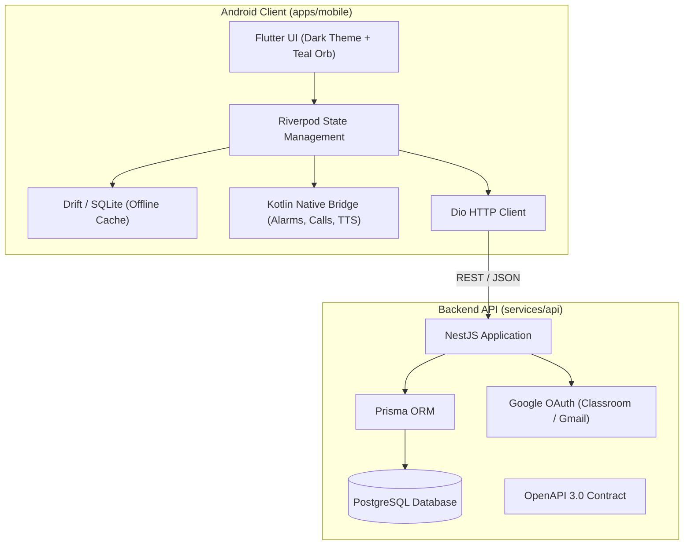

# LifeOS MVP Specification

## 1. Product Overview

- **Product Name**: LifeOS
- **Product Owner & User**: Aditya Madala
- **Target Platform**: Android APK (first release) + NestJS Backend Service
- **Pilot Duration**: 14-day personal pilot (including two Sunday planning cycles)
- **Primary Timezone**: Asia/Kolkata (IST, UTC+05:30)
- **Figma Design Reference**: [LifeOS Prototype](https://www.figma.com/design/iqRa205UsjprZdKeiNzZcF/Untitled?node-id=0-1)

LifeOS is an intelligent, offline-first personal assistant designed to automate coursework intake, plan daily focus sessions, provide interactive spoken reminders with an incoming call UI, and streamline daily health tracking (nutrition, water, workouts, steps).

---

## 2. Daily Routine & Schedule (Editable Defaults)

All schedules and days are configurable with Asia/Kolkata defaults:

| Time | Event | Experience & Logic |
| :--- | :--- | :--- |
| **06:15 AM** | **Wake Alarm (Hard Mode)** | Android alarm with audio. Hard mode requires solving two distinct puzzles (arithmetic, number patterns, or memory). Features 5-minute snooze and accessible dismiss. Upon "I'm up", speaks the morning briefing (first commitment, breakfast, top study task). |
| **08:00 AM – 03:00 PM** | **College** | Scheduled academic commitments. Reminders suppressed or set to notification-only unless flagged urgent. |
| **03:00 PM – 05:00 PM** | **Library Study Session** | Structured block:  • 03:00–03:10: Plan & setup • 03:10–04:20: Focus block (70 min) • 04:20–04:30: Break • 04:30–05:00: Review, submission, or next action logging. |
| **05:00 PM – 05:30 PM** | **Travel & Snack Buffer** | Transition time before gym. Pre-gym snack reminder (banana). |
| **05:30 PM – 07:30 PM** | **Gym / Workout** | Selected training days. In-app workout logger for exercises, sets, reps, and weights. |
| **08:45 PM** | **Evening Check-In** | Review daily steps and water totals. Avoids duplicate alerts when the user is using the existing ChatGPT check-in. |
| **10:30 PM** | **Wind-Down** | Optional preparation for sleep. |
| **11:00 PM – 06:15 AM** | **Bedtime & Quiet Hours** | Reminders suppressed, except critical wake alarms. |
| **Sunday ~07:00 PM** | **Weekly Agenda Preview** | Reviews the upcoming Monday–Sunday schedule, top 3 academic priorities, and study slot allocations against deadlines. |

---

## 3. Call-Style Reminders (Core Differentiator)

Timed tasks default to **"Call me"** (overridable to "Notification only" or "Off"):
- **Incoming State**: Android full-screen alert featuring the signature teal LifeOS orb, task title, and three primary actions: **Answer**, **Snooze** (5 min), and **Dismiss**.
- **Answered State**: Stops ringing, animates orb, and speaks the reminder text via TTS while displaying the spoken message on-screen.
- **Contextual Inline Actions**:
  - *Water Reminder*: Offers "Log water" with an editable quick-entry field (+250 ml / +500 ml).
  - *Other Tasks*: Offers "Mark done" and "Add 15m".
- **Pending Guarantee**: Answering, dismissing, or ending the call leaves unfinished tasks pending.
- **Grouped Deliveries**: Tasks due at the same minute are batched into a single call session with separate individual action cards.
- **Native Reliability**: Implemented using Android's `AlarmManager` (`SCHEDULE_EXACT_ALARM`), `NotificationManager` (`USE_FULL_SCREEN_INTENT`), and native Kotlin bridge with reboot rescheduling.

---

## 4. Voice & Task Inbox (JARVIS Experience)

- **Interaction**: Push-to-talk mic button or typed fallback with live transcript.
- **Core Voice Commands**:
  1. *"What's next?"* -> Spoken answer of current/upcoming task.
  2. *"What's due this week?"* -> Breakdown of pending deadlines.
  3. *"Check Classroom and email"* -> Triggers sync and surfaces new cards in Inbox.
  4. *"Add a 45-minute study session tomorrow"* -> Schedules study block.
  5. *"Remind me one day before"* -> Schedules reminder for selected task.
- **Safety & Confirmation**: Actions are structured into proposals and previewed to the user. Approval is required before modifying schedules or database records.
- **Date Disambiguation**: Incomplete or ambiguous dates prompt a follow-up question. Dates without times are marked *"Time unspecified"*; missing dates are marked *"Deadline unconfirmed"*.
- **Integrations (Google Classroom & Gmail)**:
  - Authorized, read-only OAuth connections.
  - Classroom: Pulls course assignments, published due dates, and student submission status.
  - Gmail: Scans strictly for coursework-labeled messages. Extracts title, snippet evidence, explicit dates, and source URLs.
  - Privacy: Unrelated emails, health logs, and meal photos are strictly excluded from AI model requests.

---

## 5. Daily Health & Routine Tracking

- **Meals**:
  - Snap/attach photo, confirm portion, and save.
  - Sub-30-second repeat meal logging with templates:
    - *Breakfast*: 50 g oats, 1 tsp chia seeds, water/milk.
    - *Lunch*: Rice, 4 whole eggs, 100 g chicken (raw weight), plain moong dal, optional vegetable.
    - *Pre-gym*: 1 banana (~4:45 PM).
    - *Dinner*: Rice, 150 g chicken (raw weight), 150–200 g vegetables.
    - *Curd*: 150 g plain curd logged once daily at lunch or dinner.
  - Automatic estimation of macronutrients and estimated grocery costs.
- **Water Tracking**:
  - Quick-add buttons (+250 ml, +500 ml) with instant Undo.
  - Daily 4 L target reference. No late-night catch-up prompts.
- **Workouts & Steps**:
  - Exercise, sets, reps, and weights logging with template history.
  - 10,000-step target from Google Fit screenshots or manual entry (labeled self-reported).

---

## 6. Architecture & Tech Stack

- **Backend**: NestJS, TypeScript, Prisma, PostgreSQL.
- **Mobile**: Flutter, Dart, Riverpod, GoRouter, Drift (SQLite), Dio.
- **Native Android**: Kotlin platform channels for `AlarmManager`, `WakeLock`, `AudioTrack`/`Ringtone`, and `TextToSpeech`.
- **Offline-First**: Drift maintains local copy of tasks, routines, meals, and water. Syncs with backend when connected.

---

## 7. Acceptance Criteria (Pilot Readiness)

| Category | Requirement | Verification Method |
| :--- | :--- | :--- |
| **Wake Alarm** | Rings when screen locked, app killed, and after phone reboot; requires solving 2 puzzles to dismiss. | Physical device verification on Android 13/14+. |
| **Call Reminder** | Shows teal orb, rings audio, speaks TTS message upon Answer, and keeps task pending if dismissed. | End-to-end device test with scheduled alarm. |
| **Classroom Sync** | Imports coursework; duplicate sync calls yield 0 duplicate tasks. | Backend QA + Contract QA automated tests. |
| **Voice & Inbox** | Ambiguous dates prompt clarification; 5 core voice commands execute reliably. | Integration test fixture. |
| **Meal Logging** | Saved template meal logs in under 30 seconds offline. | UI benchmark test. |
